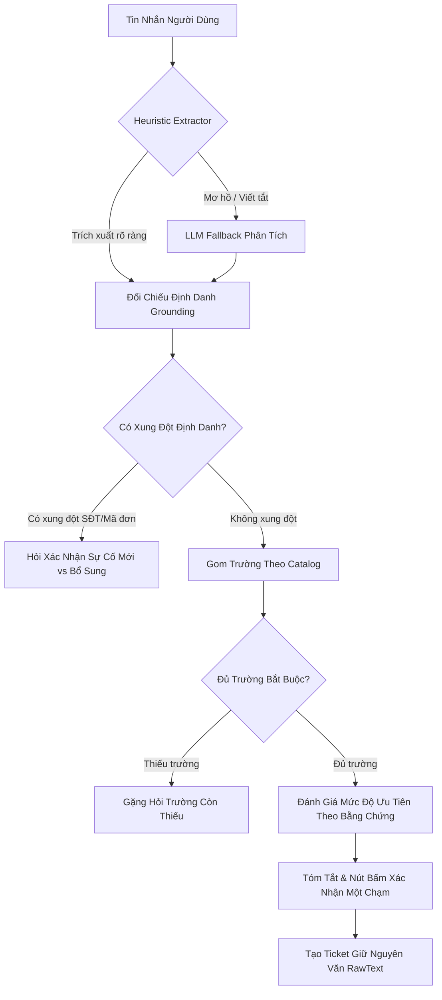

# Phân Tích Dữ Liệu Ca Done & Xây Dựng Bộ Kiểm Chuẩn Vàng (Golden Dataset)

Tài liệu nghiên cứu chuyên sâu về kho dữ liệu 380+ ca sự cố kỹ thuật đã giải quyết (`Done`) trên production của Tiểu Linh, phân tích các ca biên phức tạp (edge cases), các điểm hạn chế cố hữu của chatbot cũ, và xác lập bộ tiêu chí đánh giá độ thông minh cho Agent tiếp nhận sự cố thế hệ mới.

Bộ dữ liệu kiểm chuẩn đi kèm: [`docs/research/golden-50-done-cases.json`](/research/golden-50-done-cases.json).

---

## 1. Bối cảnh & Phương pháp Nghiên cứu

### 1.1. Bối cảnh Vận hành Thực tế
Trên máy chủ production, Tiểu Linh phục vụ mạng lưới người dùng nội bộ đa dạng gồm hàng nghìn nhân sự:
- **Tư vấn tuyển sinh (Sale)**: Thường xuyên thao tác lên đơn, đổi khóa học, đối soát mã đơn hàng, phản ánh lỗi trùng tài khoản khách hàng.
- **Chăm sóc khách hàng (CSKH / CSHV)**: Tiếp nhận trực tiếp phàn nàn của phụ huynh, học sinh về việc không vào được lớp học, mất âm thanh, lỗi đăng nhập OTP, thắc mắc về điểm số bài kiểm tra.
- **Quản lý lớp & Điều phối (QLL)**: Phụ trách sắp xếp ca học gia sư, chuyển đổi hình thức học, đối soát chuyên cần và ca tiếp sóng (CTS).
- **Chuyên môn & Vận hành (OP / Content)**: Quản lý kịch bản bài học, cấp quyền ngân hàng câu hỏi, xử lý sự cố lỗi nội dung bài tập.

Dữ liệu các ca đã `Done` phản ánh chân thực văn phong giao tiếp thực tế: giàu tiếng lóng nghiệp vụ, viết tắt nhanh trong giờ cao điểm, nhiều ca thông tin ban đầu rất sơ sài hoặc báo hộ phòng ban khác.

### 1.2. Quy trình Vệ sinh Dữ liệu & Bảo mật PII (`SECURITY.md`)
Dữ liệu trích xuất từ kho lưu trữ máy chủ đã trải qua quy trình khử định danh (PII Redaction) nghiêm ngặt để đảm bảo an toàn tuyệt đối cho repo công khai:
- **Số điện thoại**: 100% số điện thoại thật được chuẩn hoá về dải số tổng hợp dành riêng cho fixture kiểm thử: `0900000001`–`0900000050` (hoặc định danh mẫu `<phone_number>`).
- **Mã Chat ID Telegram**: Chuyển đổi về dải chat ID giả định: `-1000000000001`–`-1000000000050`.
- **Định danh nhân sự**: Quy chuẩn hoá toàn bộ tên người thật theo mẫu `name_code` chuẩn của repo (`^[A-Z]{2,4}_[A-Za-z0-9_]+$`), ví dụ: `SA_NhanVien_01`, `CS_NhanVien_02`, `QLL_DieuPhoi_03`.
- **Hạ tầng & Hệ thống nội bộ**: Khử toàn bộ URL nội bộ, thay thế bằng tên miền trung lập `*.example.com`, IP nội bộ đưa về dải loopback/generic `10.0.0.x`.
- **Kiểm định**: Kết quả chạy `bun run scan` đạt sạch 100%, không vi phạm bất kỳ quy tắc an ninh nào.

---

## 2. Thống Kê Phân Bố 380+ Ca Sự Cố Kỹ Thuật Thực Tế

Phân tích định lượng trên 380 ca sự cố đã hoàn tất (`Done` và `Resolved`) cho thấy bức tranh phân bố toàn diện về hạ tầng và nghiệp vụ của VuiHoc:

### 2.1. Phân Bố Theo Hệ Thống (System Distribution)

| Hệ thống chuẩn (`system`) | Số lượng ca | Tỷ lệ (%) | Đặc điểm sự cố chính |
|---|---|---|---|
| `CRM_Vuihoc` | 140 | 36.8% | Lỗi tạo đơn, trùng thông tin học sinh, lỗi tổng đài SIP, đối soát đơn hàng |
| `TUTOR_Vuihoc` (ERP/App Gia sư) | 93 | 24.5% | Lỗi BTVN không mở được, đổi ca học, lỗi hồ sơ gia sư, xếp lớp 1-1 và nhóm |
| `Vuihoc` (App/Web Mobile + ERP Duo) | 66 | 17.4% | Lỗi ứng dụng Duo giật lag, văng phòng, lỗi âm thanh 502, kịch bản ERP |
| `CARE_Vuihoc` | 57 | 15.0% | Không hiển thị CTS, mất số buổi học, lỗi xem báo cáo chuyên cần |
| `LMS_Vuihoc` | 49 | 12.9% | Tính sai hạn khóa học, pending khóa học, lỗi đồng bộ quyền học VIP Duo |
| `Khác_Hạ tầng_IT` | 41 | 10.8% | Khóa email công ty Zimbra, máy chấm công vân tay, sập website chính |
| `OMS_Vuihoc` | 6 | 1.6% | Lỗi đồng bộ dữ liệu giao dịch đơn hàng sang đối soát kế toán |
| `ClassIn` | 5 | 1.3% | Màn hình đen khi học trực tuyến, không đồng bộ tài khoản học sinh |
| `VNESCHOOL` | 4 | 1.1% | Lỗi kéo thả bài tập trắc nghiệm, trùng tài khoản khi import |

> *Ghi chú*: Tổng số lượng theo hệ thống vượt 380 do một số ca phức tạp liên quan đến việc đồng bộ dữ liệu chéo giữa 2 hệ thống (ví dụ: CRM và CARE).

### 2.2. Phân Bố Theo Sản Phẩm (Product Distribution)

- **Tutor (Gia sư trực tuyến)**: **45.8%** (174 ca). Là sản phẩm có luồng nghiệp vụ phức tạp nhất do có sự tham gia của phụ huynh, gia sư, quản lý lớp và hệ thống bài tập riêng.
- **Duo (Tự học song ngữ)**: **25.0%** (95 ca). Tập trung vào các lỗi ứng dụng di động, đồng bộ bài học và gia hạn gói học.
- **Tự học**: **13.7%** (52 ca). Chủ yếu liên quan đến phân quyền nội dung trên LMS và hạn sử dụng khóa học.
- **Khác / Hạ tầng**: **33.9%** (129 ca). Gồm các công cụ nội bộ, email, phân hệ kế toán, CRM.
- **Pas & VNESchool**: **2.7%** (10 ca). Luyện thi và nền tảng trường học.

### 2.3. Phân Bố Theo Bộ Phận Báo (Reporting Department)

```text
Sale (Tư vấn tuyển sinh):       ████████████████████████████ 59.5% (226 ca)
CSKH (Chăm sóc khách hàng):     ██████████ 21.6% (82 ca)
Quản lý lớp (Điều phối gia sư): █████████ 19.7% (75 ca)
Vận hành (Operations):          ██████ 13.2% (50 ca)
Vận đơn (Logistics):            █ 2.9% (11 ca)
CSHV (Chăm sóc học viên):       █ 2.4% (9 ca)
Chuyên môn (Curriculum):        █ 1.8% (7 ca)
Kế toán (Finance):              0.3% (1 ca)
```

**Nhận xét mấu chốt**: Gần **60%** lượng ticket phát sinh từ đội ngũ **Sale**. Nhóm người dùng này có đặc thù gõ tin nhắn rất ngắn gọn, thường xuyên gửi chỉ kèm số điện thoại hoặc mã đơn hàng, đòi hỏi bot phải có khả năng suy đoán ngữ cảnh và gặng hỏi thông minh thay vì từ chối cứng nhắc.

### 2.4. Phân Bố Mức Độ Ưu Tiên & Vấn Đề "Lạm Phát Khẩn Cấp" (Urgency Inflation)
Trên biểu mẫu Google Form và hệ thống cũ:
- **79%** ca được người dùng tự đánh dấu là `Urgent`.
- **20%** ca đánh dấu là `High`.
- Chỉ chưa đầy **1%** ca được đánh dấu là `Medium` hoặc `Low`.

Hiện tượng này tạo ra tình trạng "báo động giả" liên tục cho đội ngũ trực kỹ thuật. Qua audit thực tế:
- 19/30 ca người dùng chọn `Urgent` thực chất chỉ là lỗi của một học sinh đơn lẻ và đã có giải pháp tạm thời (workaround), theo chuẩn chỉ tương đương mức `High`.
- Ngược lại, có 6/10 ca sai lệch số liệu đối soát doanh thu (`reconciliationMismatch`) người dùng chọn `Medium`, nhưng thực tế cần xử lý ngay trong ngày (`High`).

Bộ quy tắc căn chỉnh ưu tiên (`urgency-rules.json`) của bot mới dựa trên **bằng chứng cấu trúc** (Structural Evidence) đã khắc phục triệt để vấn đề này.

---

## 3. Phân Tích Chuyên Sâu 5 Nhóm Ca Biên Thử Thách Nhất (50 Ca Kiểm Chuẩn Vàng)

Bộ 50 ca kiểm chuẩn trong `golden-50-done-cases.json` được tuyển chọn đại diện cho 5 thử thách lớn nhất trong tiếp nhận sự cố:

### Nhóm 1: Thiếu Trường & Bổ Sung Qua Nhiều Lượt (Multi-turn Clarification - 10 ca: `GOLDEN-01` -> `GOLDEN-10`)
- **Bản chất**: Người báo không bao giờ gửi đầy đủ thông tin kỹ thuật trong một tin nhắn duy nhất. Tin nhắn đầu tiên thường chỉ là lời than phiền ngắn gọn: *"App không làm bài được"*, *"Lỗi CRM"*, *"Không tạo được đơn"*.
- **Đặc trưng kiểm thử**:
  + Duy trì bộ nhớ trạng thái (State Tracking) qua 3 đến 4 lượt trò chuyện.
  + Nhận diện các trường đã có để **chỉ hỏi các trường còn thiếu** (ví dụ: đã có SĐT thì chỉ hỏi thiết bị/OS hoặc mã bài tập).
  + Khả năng moi định danh (Identifier Grounding) từ tin nhắn bổ sung ngắn ngủi (ví dụ: chỉ nhắn *"0900000012"* ở lượt 2 thì bot phải tự hiểu đây là số điện thoại phụ huynh cần bổ sung cho tờ khai).

### Nhóm 2: Tiếng Lóng & Viết Tắt Của Giáo Viên / CS (Slang & Abbreviations - 10 ca: `GOLDEN-11` -> `GOLDEN-20`)
- **Bản chất**: Ngôn ngữ giao tiếp nội bộ trong EdTech chứa mật độ thuật ngữ viết tắt rất cao.
- **Bảng đối soát thuật ngữ lóng thực tế**:

| Thuật ngữ lóng | Ý nghĩa nghiệp vụ thực tế | Phân loại chuẩn trong Bot mới |
|---|---|---|
| `CTS` | Ca tiếp sóng / Chuyển trạng thái học viên | Thuộc phân hệ `Tutor` / `CARE_Vuihoc` |
| `cuốn chiếu` | Học dứt điểm từng môn (hết Lý mới sang Hóa) | Hình thức tổ chức lớp học Gia sư |
| `song song` | Học đồng thời cả 3 môn trong tuần | Hình thức tổ chức lớp học Gia sư |
| `4B CLC` | 4 buổi học lớp Chất lượng cao | Dữ liệu số buổi học (`Tutor`) |
| `kho QLL` | Hàng đợi điều phối của Quản lý lớp | Giao diện điều phối trên `CARE_Vuihoc` |
| `CC` | Chuyên cần (điểm danh/tham gia buổi học) | Trường dữ liệu `Lỗi dữ liệu` trên Duo/CRM |
| `PCM` | Khối Tự nhiên: Physics - Chemistry - Math | Gói combo chuyển phí môn học |
| `UID` | Mã định danh người dùng trên LMS | Trường `identifiers.uid` |
| `đổi ca` | Thay đổi lịch dạy/học của lớp | Ngữ cảnh ảnh hưởng nhóm (`scope=group`) |
| `BTVN` | Bài tập về nhà | Mục kiểm tra bài tập (`Tutor`) |
| `GTC` | Đơn hàng COD giao thành công | Nghiệp vụ Vận đơn / Kế toán |
| `T5` | Trạng thái hoàn tất đối soát bưu điện | Cột trạng thái đơn hàng trên CRM |

### Nhóm 3: Báo Nhiều Lỗi Cùng Lúc Hoặc Đổi Ý Giữa Chừng (Multi-incident & Revision - 10 ca: `GOLDEN-21` -> `GOLDEN-30`)
- **Bản chất**: Người dùng báo 2 lỗi trong 1 tin (W29-SPLIT), hoặc đang khai dở thì đổi ý ("thôi được rồi", "hủy giúp em"), hoặc sửa đổi thông tin vừa cung cấp ("nhầm số rồi, số đúng là...").
- **Điểm đột phá kỹ thuật**:
  + **Chống va chạm định danh (Anti-collision, TECH-928)**: Khi tờ khai đang chờ xác nhận SĐT A mà người dùng gửi tiếp SĐT B, bot bắt buộc phải kích hoạt action `ask_new_or_continue` thay vì gộp lặng lẽ.
  + **Cơ chế xác nhận một chạm (One-tap confirmation, ADR-0006)**: Hủy (`Canceled`) hoặc đóng (`Done`) ticket luôn hiện bản xem trước và nút bấm rõ ràng (`[✅ Hủy TECH-X]` / `[Giữ lại]`), tuyệt đối không dùng nhãn "Huỷ" mơ hồ.
  + **Tách biệt luồng tờ khai mới (Draft isolation, TECH-1013)**: Tin nhắn gửi ngay sau khi tạo ticket nói "ticket mới ạ" phải mở tờ khai mới, không được nuốt chửng vào ticket cũ.

### Nhóm 4: Báo Hộ Phòng Ban Khác (Cross-Department Reporting - 10 ca: `GOLDEN-31` -> `GOLDEN-40`)
- **Bản chất**: Người báo thuộc một phòng ban (thường là Sale hoặc CSKH), nhưng nội dung sự cố lại phản ánh lỗi của hệ thống thuộc phòng ban khác (Vận đơn, Kế toán, Quản lý lớp, Hạ tầng IT).
- **Nguyên tắc xử lý**:
  + Tách bạch hai khái niệm: **Phòng ban người báo** (`reporting_dept` = Sale/CSKH) và **Phân hệ nghiệp vụ bị lỗi** (`system` = OMS, LMS, Hạ tầng).
  + Không bắt ép người báo phải chọn lại phòng ban theo nghiệp vụ lỗi.

### Nhóm 5: Sự Cố Khẩn Cấp & SLA Gấp (Urgent Incidents & High SLA - 10 ca: `GOLDEN-41` -> `GOLDEN-50`)
- **Bản chất**: Các sự cố sập hạ tầng, đứt gãy phòng học trực tiếp hoặc chặn dòng tiền thanh toán.
- **Cơ chế kích hoạt khẩn cấp (Emergency Floor Rules)**:
  + `blocksPayment = true`: Phụ huynh quét QR / thanh toán thẻ bị lỗi 500/502 -> Cố định sàn `Urgent`.
  + `blocksLearning = true` & `scope = entire_system | group`: Sập phòng học ClassIn, lỗi 504 khi cả lớp nộp BTVN, sập audio Duo trong khung giờ cao điểm 19h-21h -> Cố định sàn `Urgent`.
  + Lỗi toàn hệ thống (Server Down, 401 Unauthorized CRM, SIP Request Timeout tổng đài) -> Bỏ qua toàn bộ câu hỏi về SĐT cá nhân, mở ticket khẩn cấp và kích hoạt còi báo động IT On-call.

---

## 4. Mổ Xẻ 7 Điểm Chatbot Cũ Hay Bị "Ngố" (Legacy Bot Failure Modes)

Dựa trên nhật ký sự cố production và các quyết định kiến trúc (ADR), 7 nhược điểm cốt tử của chatbot thế hệ cũ gồm:

```text
┌────────────────────────────────────────────────────────────────────────┐
│             7 "TẬT XẤU" KINH ĐIỂN CỦA CHATBOT THẾ HỆ CŨ                │
├──────────────────────────────────┬─────────────────────────────────────┤
│ 1. Hỏi lại phòng ban ngớ ngẩn    │ Người dùng đã khai "Em bên Sale"    │
│                                  │ nhưng bot vẫn hỏi lại bộ phận       │
├──────────────────────────────────┼─────────────────────────────────────┤
│ 2. Đòi hỏi trường vô nghĩa       │ Sập tổng đài SIP hoặc sập website   │
│                                  │ nhưng bot vẫn đòi SĐT học sinh      │
├──────────────────────────────────┼─────────────────────────────────────┤
│ 3. Điếc trước tiếng lóng EdTech  │ Không hiểu CTS, 4B CLC, PCM         │
│                                  │ đẩy hết vào "Lỗi chưa xác định"     │
├──────────────────────────────────┼─────────────────────────────────────┤
│ 4. Gộp lặng lẽ hai sự cố khác    │ Báo đơn A xong gửi đơn B -> ghi đè  │
│    nhau (Sự cố TECH-928)         │ mất trắng dữ liệu của đơn A         │
├──────────────────────────────────┼─────────────────────────────────────┤
│ 5. LLM tự bịa văn xuôi thay vì   │ Tự ý tóm tắt thêm thắt suy đoán cá  │
│    giữ nguyên văn (TECH-1084)    │ nhân làm sai lệch mô tả ticket      │
├──────────────────────────────────┼─────────────────────────────────────┤
│ 6. Nhầm nhãn nút "Huỷ" gây hoang │ Nút từ chối thao tác đặt tên "Huỷ"  │
│    mang (Sự cố TECH-951)         │ làm người dùng tưởng là huỷ ticket  │
├──────────────────────────────────┼─────────────────────────────────────┤
│ 7. Tự động ghi comment vào       │ Người dùng gửi tin nhắn sau tạo     │
│    ticket cũ khi chưa xác nhận   │ bot tự append nhầm sự cố mới        │
└──────────────────────────────────┴─────────────────────────────────────┘
```

### Chi tiết lỗi TECH-1084 (Vi phạm tính nguyên văn):
Ở bản cũ, khi LLM gọi `create_issue`, nó tự ý viết lại lời người báo thành văn xuôi bóng bẩy:
> *"Học sinh Nguyễn Văn Anh D báo trên app... Hệ thống xác định ban đầu là VH_Tự học, người báo đã xác nhận đúng hệ thống là Vui học Gia sư. Cần đối chiếu dữ liệu bài tập về nhà trên hệ thống Gia sư."*

Hai câu trên hoàn toàn là suy luận nội bộ của model, không phải lời người báo. Hệ quả:
1. Mất dấu vết lời khai nguyên văn của người dùng khi kỹ thuật viên vào điều tra.
2. Thuật toán tìm kiếm ticket tương tự (BM25) dựa trên triệu chứng bị sai lệch hoàn toàn vì mất từ khóa gốc.

---

## 5. Bộ Tiêu Chí Đánh Giá Độ Thông Minh Cho Agent Thế Hệ Mới (Scorecard)

Để một AI Agent tiếp nhận sự cố được chứng nhận sẵn sàng cho production, Agent cần vượt qua bộ 7 tiêu chí đánh giá ngoại tuyến trên 50 kịch bản vàng:



### Bảng Tiêu Chí & Ngưỡng Đạt Chuẩn (Benchmark Targets):

| Mã | Tên Tiêu Chí | Trọng số | Chỉ số đo lường | Mục tiêu Đạt (Pass) |
|---|---|---|---|---|
| **C1** | **Multi-turn State Retention** | 20% | F1-Score trên các trường trích xuất qua >= 3 lượt | **≥ 95%** |
| **C2** | **Slang & Taxonomy Resolution** | 15% | Tỷ lệ ánh xạ đúng System, Product từ tiếng lóng | **≥ 90%** |
| **C3** | **Identifier Collision Detection** | 15% | Tỷ lệ chặn gộp đè khi có 2 định danh xung đột | **100% (Zero-tolerance)** |
| **C4** | **One-tap Safe Confirmation** | 15% | Tỷ lệ hiển thị bản xem trước trước khi đột biến DB | **100% (Zero-tolerance)** |
| **C5** | **Priority Calibration Accuracy** | 15% | Tỷ lệ khớp Urgency tính toán theo luật sàn/trần | **≥ 92%** |
| **C6** | **Verbatim RawText Preservation** | 15% | Độ tương đồng BLEU/Exact Match lời kể người báo | **100% nguyên văn** |
| **C7** | **Graceful Handling of System Outage**| 5% | Tỷ lệ bỏ qua đòi hỏi SĐT cá nhân khi sập hệ thống | **100%** |

---

## 6. Hướng Dẫn Tích Hợp Vào Harness Kiểm Thử Ngoại Tuyến

Tập dữ liệu `golden-50-done-cases.json` được thiết kế để nạp trực tiếp vào bộ chạy kiểm thử kịch bản (`ScriptedChat`) của `@vuihoc/bot-core/testing`.

Ví dụ mã nguồn phát lại kịch bản kiểm thử:

```ts check
import {
  type CopyCatalog,
  type ExtractedFields,
  type FieldExtractorPort,
  IntakeEngine,
  intakeApplySchema,
  SqliteChannelBindingStore,
  SqliteDraftRepository,
  type TrackerPort,
  createCatalog,
} from "@vuihoc/bot-core/intake";
import { ManualClock, ScriptedChat } from "@vuihoc/bot-core/testing";
import { Database } from "bun:sqlite";

// Nạp catalog chuẩn và engine
const db = new Database(":memory:");
intakeApplySchema(db);
const clock = new ManualClock();

const queue: ExtractedFields[] = [];
const extractor: FieldExtractorPort & { push(...f: ExtractedFields[]): void } = {
  push: (...f) => void queue.push(...f),
  extract: async () => queue.shift() ?? { userIntent: "chitchat" },
};

const tracker: TrackerPort = {
  createIssue: async (input) => ({ id: 1001, identifier: "TECH-1001", title: input.title }),
  getIssue: async () => null,
  addComment: async () => {},
  attach: async () => 0,
  findByIdentifier: async () => null,
};

const catalog = createCatalog({
  fields: {
    _toi_da_hoi_lai: 2,
    _toi_da_truong_moi_luot: 1,
    nhanh: {
      tech: {
        ten: "Sự cố kỹ thuật",
        truong_mo_dau: "van_de",
        recap: ["van_de", "bo_phan"],
        truong: {
          van_de: { bat_buoc: true, kieu: "text", duoc_hoi: true, nhan: "Vấn đề", hoi: "Vấn đề là gì ạ?" },
          bo_phan: { bat_buoc: true, kieu: "text", duoc_hoi: true, nhan: "Bộ phận", hoi: "Anh/chị bên bộ phận nào ạ?" },
        },
      },
    },
  },
});

const copy: CopyCatalog = { text: (key) => key };

const engine = new IntakeEngine({
  tracker,
  drafts: new SqliteDraftRepository(db),
  bindings: new SqliteChannelBindingStore(db),
  copy,
  clock,
  extractor,
  catalog,
  variant: "tech",
  urgencyRules: { levels: ["Low", "Medium", "High", "Urgent"], floors: [], ceilings: [] },
  identifierPrefix: "TECH",
});

// Chạy kiểm thử cho kịch bản GOLDEN-01
extractor.push(
  { userIntent: "report_issue", values: { van_de: "Học sinh không vào làm bài tập Toán" } },
  { userIntent: "provide_info", values: { bo_phan: "Quản lý lớp" } },
  { userIntent: "confirm" },
);

const run = await new ScriptedChat({ engine, clock, extractor }).run({
  name: "GOLDEN-01-clarification",
  turns: [
    { say: "Học sinh KH147861 không vào làm bài tập Toán gia sư", expect: { outcome: "asked" } },
    { say: "Quản lý lớp em nhé", expect: { outcome: "summary" } },
    { say: "button.confirm_create", advanceMs: 10_000, expect: { outcome: "created" } },
  ],
});

run.assertOk();
```

---

## 7. Kết Luận & Lộ Trình Triển Khai (Phase 2)

Nghiên cứu trên 380+ ca Done thực tế đã chứng minh rằng:
1. **Tiếp nhận sự cố kỹ thuật không phải bài toán sinh ngôn ngữ tự do**, mà là bài toán quản lý trạng thái hội thoại (State Machine) kết hợp đối soát thực thể chặt chẽ.
2. **Logic tất định nằm ở Engine và Tooling**, prompt chỉ đảm nhiệm vai trò giao tiếp thân thiện.
3. Bộ 50 ca kiểm chuẩn vàng (`golden-50-done-cases.json`) cùng bản phân tích này đóng vai trò là "thước đo chất lượng không trôi" (Anchor of Truth), bảo đảm Tiểu Linh thế hệ mới không mắc lại bất kỳ lỗi kinh điển nào của thế hệ cũ trước khi chính thức đưa vào phục vụ hàng nghìn người dùng.
